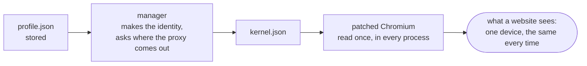

<p align="center">
  <picture>
    <source media="(prefers-color-scheme: dark)" srcset="branding/proteus-logo-dark.svg">
    
  </picture>
</p>

<h3 align="center">One browser. Many devices. Each one keeps its shape.</h3>

<p align="center">
  A patched Chromium and a small manager that give every profile a device of its own:<br>
  its own cookies, its own screen, graphics card, fonts and voice, the same every time it starts.
</p>

<p align="center">
  <a href="https://github.com/Sheekovic/Proteus-Browser/releases/latest"></a>
  
  
  <a href="https://github.com/Sheekovic/Proteus-Browser/actions/workflows/manager-tests.yml"></a>
  <a href="LICENSE"></a>
</p>

<p align="center">
  <a href="#download"><b>Download</b></a> ·
  <a href="https://sheekovic.github.io/Proteus-Browser/test.html"><b>Test your browser</b></a> ·
  <a href="#what-a-profile-controls">What it changes</a> ·
  <a href="guide/api.md">API</a> ·
  <a href="guide/automation.md">Automation</a> ·
  <a href="guide/limitations.md">Limitations</a> ·
  <a href="ROADMAP.md">Roadmap</a>
</p>

---

> In the old story Proteus, the old man of the sea, became a lion, a serpent, water,
> a tree: whatever shape kept him from being held. The one who held on through every
> change got the truth out of him.
>
> A Proteus profile takes one shape and holds it. A site that reads it a hundred ways
> gets the same device a hundred times, and never the machine underneath.

## The two halves

<table>
<tr>
<td width="50%" valign="top">

### 🌊 The kernel

Patches on top of Chromium that let one JSON file decide how the browser describes
its device: user agent and client hints, screen, graphics card, fonts, voices, time
zone, location, and the small rendering differences that canvas, WebGL and audio
fingerprints are made of.

Nothing is injected into pages. The values change where Chromium computes them.

</td>
<td width="50%" valign="top">

### 🔱 The manager

A small local app that stores profiles, makes a coherent device identity for each
one, matches it to its proxy, and starts the kernel with it.

A window to click in, a JSON API, and MCP tools for AI assistants. No dependencies:
Node's standard library only.

</td>
</tr>
</table>



The kernel reads its configuration once at start and hands it to its child processes.
There is no extension and no script running before the page's own, so the values are
the same in the page, in iframes and in workers, and native functions still look
native. Without a profile the kernel behaves like the Chromium it is built from.

## Download

| System | File | Start it |
| --- | --- | --- |
| **Windows** 10 and 11, 64-bit | [`Proteus-…-win-x64.zip`](https://github.com/Sheekovic/Proteus-Browser/releases/latest) | `Start Proteus.cmd`, or `Install Proteus.cmd` first (no administrator rights) |
| **Linux**, 64-bit | [`Proteus-…-linux-x64.tar.xz`](https://github.com/Sheekovic/Proteus-Browser/releases/latest) | `./start-proteus.sh` |

Each is one folder with everything in it: the kernel, the manager, the Node.js runtime
it needs and the fonts profiles are drawn with. Unpack, start, create a profile, press
**Start**. Then see how the profile looks to a website on the
[test page](https://sheekovic.github.io/Proteus-Browser/test.html).

> [!NOTE]
> **A first release.** Tested on Windows 11, Windows Server 2022 and Ubuntu. Nothing is
> code-signed yet, so Windows warns before running it (*More info*, then *Run anyway*).
> What a profile does not hide is under [Limitations](#limitations).

> [!TIP]
> On Linux systems that restrict unprivileged user namespaces (Ubuntu 23.10 and later)
> the start script says so and names the one command that lets the browser use its
> sandbox: `sudo ./linux-sandbox.sh --install`.

**It updates itself, when you say so.** At each start the manager asks GitHub which
release is the newest; a bar in the window offers an **Update** button, and nothing is
downloaded before you press it. The download is checked against the release's signed
list of checksums. Profiles and settings stay as they are.
[How updates work →](guide/updates.md)

## What a profile controls

| | Area | What changes |
| :-: | --- | --- |
| 🪪 | **Identity** | `navigator.userAgent`, `platform`, `vendor`, client hints in script and in request headers, with brand lists built the way that Chrome version builds them |
| 🖥️ | **Hardware** | Processor count, device memory, the screen, its work area and its scale |
| 🎨 | **Graphics** | WebGL vendor and renderer, the card's limits, extensions and shader precision, WebGPU adapter info |
| 🧬 | **Fingerprints** | Canvas, WebGL and audio readbacks carry a small noise from the profile's seed: stable for a profile, different between profiles |
| 🔤 | **Fonts** | An allow-list of installed fonts; Android's own fonts come with Proteus, and stand-ins with the right measures for Windows' and Apple's |
| 🌍 | **Locale** | Languages, `Accept-Language`, time zone: those of the place the proxy comes out in |
| 📡 | **Network** | WebRTC that never reveals the machine's address; a TLS and HTTP/2 handshake that fits the claimed browser |
| 📍 | **Location** | The position `navigator.geolocation` reports |
| 🗣️ | **Speech** | The list of speech synthesis voices |
| 🎥 | **Devices** | Which microphones, cameras and speakers exist and what they are called; a covered lens instead of your room; the battery; on Android, the kind of connection |
| 📱 | **Phones** | Android (Chrome) and iPhone (Safari) profiles: phone screen, touch, pixel ratio, mobile layout, and the names each browser has or lacks |

<details>
<summary><b>Why the noise does not give itself away</b></summary>
<br>

The noise is deliberately conservative. It is applied only to content that already
differs between devices (text, curves, gradients), never to flat fills or to pixels a
page wrote itself, so the checks sites use to catch noise — draw a known colour, read
it back — still pass. Reading the same thing twice gives the same answer.

</details>

## What the manager does

**Profiles**
- Plain JSON files, each with its own browser data directory.
- Identity generators for Windows, macOS, Linux, Android and iPhone, and ready-made
  setups (ordinary laptops, desktops and phones) to choose from instead. A Windows or
  Mac identity gets a graphics card read from a real computer, with its capabilities.
- Many at once from a pasted proxy list, each a device of its own; editing,
  duplicating and tagging them; cookies in and out as the files other browsers export.

**Proxies**
- Per profile, HTTP and SOCKS5, with or without a login; checked before use (where one
  comes out, and how fast), and tolerant of the way real ones behave.
- **A profile behind a proxy is a browser of the place the proxy comes out in.** Before
  each start the exit is looked up, and the time zone, the languages (the list of a
  Chrome installed in that country's language), the position and the WebRTC address
  are the exit's. A value you set yourself stays. A profile whose exit's time zone
  nobody can tell does not start, rather than show this machine's.
- A profile that came out at the same address twice starts without waiting for the
  lookup, which is repeated while the browser comes up.

**Driving it**
- Everything the window does a program can do: a [JSON API](guide/api.md), and the
  same abilities as [MCP tools](guide/automation.md#mcp-for-ai-assistants) for AI
  assistants. Both are bound to `127.0.0.1` only.
- Not only starting the browser: open tabs, go to a page, read its text, run a script
  in it, take a picture of it, read and set cookies.
- Every started profile exposes a DevTools endpoint, so
  [Puppeteer, Playwright or Selenium](guide/automation.md) can drive it directly.

**Itself**
- A light interface in a window of its own, drawn by the kernel, so nothing heavier
  than a web page is running.
- Starts with the computer if you tick it in the settings. Off until you do.
- Updates itself from the releases on GitHub, when you say so.

## Drive it from a program

```bash
# Create a profile
curl -X POST http://127.0.0.1:5310/api/profiles \
     -H 'Content-Type: application/json' \
     -d '{"name": "Shop account", "os": "windows", "timezone": "Europe/Berlin"}'

# Start it; the reply carries a DevTools endpoint ("debuggerUrl")
curl -X POST http://127.0.0.1:5310/api/profiles/<id>/start \
     -H 'Content-Type: application/json' -d '{}'
```

```js
// Puppeteer. defaultViewport: null leaves the window as the profile has it.
const browser = await puppeteer.connect({ browserURL: status.debuggerUrl, defaultViewport: null });

// Playwright. Use the context that is there: it has the profile's cookies.
const browser = await chromium.connectOverCDP(status.debuggerUrl);
const page = await browser.contexts()[0].newPage();
```

| Guide | What is in it |
| --- | --- |
| [**The API**](guide/api.md) | Every route by example, the shape of a profile's state, ready-made setups, the handshake report (TLS and HTTP/2 against the claim), memory, start times |
| [**Driving a profile**](guide/automation.md) | Puppeteer, Playwright and Selenium with the bundled driver, what a detection page finds, what a profile's camera shows, MCP for AI assistants |
| [**Updates**](guide/updates.md) | What is asked, what is fetched, how a release is checked and signed |
| [**Limitations**](guide/limitations.md) | Everything a profile does not hide, in full |

> [!WARNING]
> The API and the MCP endpoint have no login. They answer only requests addressed to
> localhost and refuse requests from other websites' pages. Whoever can reach them can
> run scripts in your profiles' pages and read their cookies, so do not put the
> manager's port behind a proxy that others can reach.

## Identities from real devices

A generated identity is built from lists of ordinary configurations. For identities
that match hardware that really exists, Proteus can read a real device and make
profiles from the reading.

1. Open the collector page on the device, in Chrome (or in Safari on an iPhone):
   - on the computer running the manager: **Device fingerprints → Read this
     computer's browser**;
   - on any other device: open [`manager/ui/collect.html`](manager/ui/collect.html)
     there. It is a single self-contained file; serve it over HTTPS so the browser
     shares its version details and model.
2. Press **Read this device**, then save the result or download it as a file.
3. Import the file in the manager and choose it under **Device identity** when
   creating a profile.

The page reads what any website can read about the device: browser and system
version, phone model, screen, processor count, memory class, graphics card name and
limits, font names from a fixed list, speech voices, and which kinds of media device
are listed (not their names). It does not read the IP address, location, language,
time zone, cookies or history, and nothing leaves the page until you press a button.

Profiles made from one reading are the same *model* of device, each with its own
noise seed — not copies of one device.

## Run it from this repository

With a [release build](#download) there is nothing to set up. To run from the source
instead you need [Node.js](https://nodejs.org) 24 or newer and a built kernel.

```bash
cd manager
PROTEUS_KERNEL=/path/to/chrome node src/main.ts --open
```

The Proteus window opens. Create a profile and press **Start**.

| Switch or variable | What it does |
| --- | --- |
| `--open` | Shows the manager in a window of its own; closing it ends Proteus, unless profiles are still running. Starting Proteus again shows that window. |
| `--open-browser` | Uses your usual browser instead. Without either, the manager only serves <http://127.0.0.1:5310>. |
| `PROTEUS_KERNEL` | Names the kernel the first time; after that it is remembered (and can be changed under **Settings**). A kernel in a `kernel` folder next to `manager` is found by itself. |
| `--port <n>`, `PROTEUS_PORT` | Another port. |
| `PROTEUS_HOME` | Another data directory (the default is `%APPDATA%\Proteus` on Windows and `~/.proteus` elsewhere). |

<details>
<summary><b>Building the kernel</b></summary>
<br>

The kernel is Chromium **157.0.8103.79** (pinned in
[`kernel/CHROMIUM_VERSION`](kernel/CHROMIUM_VERSION)) with the patches in
[`kernel/patches`](kernel/patches) applied in order. BoringSSL, the TLS library, is a
repository of its own inside a Chromium checkout, so the one patch that touches it is
kept apart, in [`kernel/patches/boringssl`](kernel/patches/boringssl).

A Chromium build needs a capable machine: roughly 100 GB of disk, 32 GB of RAM, and
hours for the first build. In outline:

1. Fetch that Chromium release and its build dependencies, following
   [Chromium's own instructions](https://chromium.googlesource.com/chromium/src/+/main/docs/get_the_code.md)
   for your platform.
2. Apply the patches:
   ```bash
   cd chromium/src
   git am /path/to/Proteus/kernel/patches/*.patch
   git -C third_party/boringssl/src am /path/to/Proteus/kernel/patches/boringssl/*.patch
   ```
3. Configure with [`kernel/args.gn`](kernel/args.gn) and build:
   ```bash
   gn gen out/Release --args="$(cat /path/to/Proteus/kernel/args.gn)"
   autoninja -C out/Release chrome
   ```

`kernel/scripts` holds the scripts this project uses to do that on a Linux build
server, including a Windows cross-build. They are written for one setup and are kept
as a reference rather than a general build system; the ones that talk to a build
server read its address from the `PROTEUS_BUILD_HOST` environment variable
(`user@host`).

On that setup a release is one command: [`release/make-release.ps1`](release/make-release.ps1)
` <version>` rebuilds the Linux kernel, runs every kernel test on it, exports the patch
series, builds the Windows kernel and assembles both bundles, stopping at the first
failure. It publishes nothing.

[`release/update-dist.ps1`](release/update-dist.ps1) keeps a `dist` folder (not
committed) that runs the current working tree as it is — the newest kernel under
`out`, the manager, a shortcut with the Proteus icon — and, with `-InstallHook`,
refreshes it after every commit.

`kernel/src` and `kernel/scripts/edits` are the patches in their editable form: new
source files, and small scripts that make the in-place edits to Chromium's own files.

</details>

<details>
<summary><b>Tests</b></summary>
<br>

**Manager** — unit and API tests, no browser needed:

```bash
cd manager
npm test
```

**Kernel** — each patch has a test page that reports what a page can observe, and a
script that compares a plain run with profile runs. On Windows, from Git Bash:

```bash
kernel/scripts/win-test.sh <folder with chrome.exe> identity locale mobile glcaps
```

**End to end** — starts the manager, creates profiles, launches the real kernel and
checks what pages see, and that the handshake agrees with the claim:

```bash
python kernel/tests/serve.py kernel/tests 8793 &
node manager/test/e2e/real-kernel.mjs <path to chrome> http://127.0.0.1:8793
```

**Automation** — drives a profile with Puppeteer and with Playwright and prints what
a page can tell (see [Driving a profile](guide/automation.md)). The two libraries are
not part of this repository:

```bash
mkdir libraries && cd libraries && npm init -y && npm install puppeteer-core playwright-core && cd ..
node manager/test/e2e/automation.mjs <path to chrome> libraries
```

**Updating** — a pretend release folder runs the manager, a pretend GitHub on this
machine offers a newer one, and the manager is asked to fetch it and put it in; the
script it leaves has to replace the folder and start Proteus again. Nothing is fetched
from the internet:

```bash
node manager/test/e2e/update.mjs
```

**Detection sites** — runs fresh Windows, Android and iPhone profiles past public
detection sites and compares each verdict with the expected one, so that a regression
(or a site getting stricter) is noticed. It needs the network and takes a while; run
it after kernel changes, before a release, or from a scheduler:

```bash
node manager/test/e2e/site-check.mjs <path to chrome>
```

[`kernel/tests/detect.html`](kernel/tests/detect.html) is a page of the consistency
checks detection scripts commonly run (does a known pixel read back unchanged, do
the page and a worker agree, do the fonts fit the claimed system, …). An unmodified
browser passes all of them, and so should a profile.

</details>

<details>
<summary><b>Repository layout</b></summary>
<br>

```
kernel/
  CHROMIUM_VERSION   the Chromium release the patches apply to
  args.gn            build settings
  patches/           the kernel, as patches (apply with git am)
  src/               new source files, in Chromium's directory layout
  scripts/           build and test scripts; edits/ makes the in-place changes
  tests/             test pages and the scripts that check them
manager/
  src/               the manager (TypeScript, run directly by Node)
  ui/                the web UI and the fingerprint collector page
  test/              unit, API and end-to-end tests
guide/               the longer texts this page points to
docs/                the website (GitHub Pages), including the browser test page
release/             what a release bundle adds, and the script that assembles one
```

</details>

## Limitations

Even Proteus could be held. Worth knowing before relying on it; each of these is told
in full, with what was measured, in [the limitations guide](guide/limitations.md).

| | In short |
| --- | --- |
| **It is Chromium underneath** | An iPhone profile says Safari, lacks what Safari lacks and shakes hands as Safari does, but a site that probes how the engine behaves can tell it is not WebKit. There is no Firefox kernel. |
| **A generated identity is put together** | Card and screen are each read from real computers, but drawn separately: a plausible computer, not a record of one. A profile made from a device's own reading is. |
| **A phone profile is a desktop engine** | It hides what the phone's browser lacks and has the names it has; some 225 Safari members are still missing, and `navigator.gpu` is hidden on an iPhone. |
| **A window's frame is this machine's** | The thickness of the bars around the page is not imitated for a Mac or a Linux desktop. |
| **A phone's screen colours** | Follow the claimed system for computers and iPhones; an Android profile gets what the monitor has. |
| **Scale** | A page is laid out at the profile's scale, the window drawn at your monitor's; a size a page asks of a window may read back a pixel or two off. |
| **Limits above the machine's** | A claimed graphics limit below the machine's is enforced; one above it cannot be given, and claimed memory is only a number. |
| **Fonts of another system** | Android's are the real ones. Windows' and Apple's may not be passed on: six have stand-ins with the same measures, and careful measurement of the glyphs can tell. |
| **Cameras** | Every camera a profile lists shows the same picture, in the same list of sizes. |
| **Tested on few machines** | What holds on one Windows 11 machine is not a guarantee elsewhere. |
| **No protection is complete** | Sites combine many signals — address reputation, behaviour, account history — that no browser controls. |

## Responsible use

Proteus is for separating identities you are entitled to have: managing several
accounts of your own, testing how sites treat different devices, research, and
privacy. Use it within the law and within the terms of the services you use. Do not
use it for fraud, to evade a ban, or to impersonate someone else.

The patches are original work written for this project. Proteus is not affiliated
with, and contains no code or data from, any commercial anti-detect browser.

## Credits and licence

Proteus is released under the [BSD 3-Clause License](LICENSE).

The kernel patches modify [Chromium](https://www.chromium.org/), which is the work of
The Chromium Authors and is distributed under its own licences (BSD 3-Clause for
Chromium itself, others for the third-party code it includes). Those continue to
apply to the code the patches are applied to.

The graphics cards a new identity is drawn from
([`manager/src/gpus.json`](manager/src/gpus.json)) are taken from readings of real
browsers that Scrapfly published with
[fingerprint-generator](https://github.com/scrapfly/fingerprint-generator) under the
Apache License 2.0 ([its text](manager/licenses/fingerprint-generator-LICENSE.txt)).
[`manager/tools/build-readings.mjs`](manager/tools/build-readings.mjs) makes the file
from a release of that model: per card, the capabilities most often read with it,
leaving out software renderers, virtual machines and readings that lack something. On
the computer this was written on, the file's entry for its own card matched what the
kernel reads there in every one of 55 limits, both extension lists and the shader
precision.

<p align="center">
  <sub>🌊 &nbsp;Hold on through every change.</sub>
</p>
